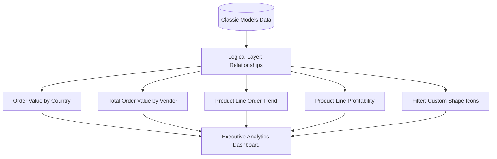

# Tableau Desktop & Cloud: Classic Models Analytics Dashboard

A modern implementation guide and visual analytics reference for building the Classic Models Executive Dashboard in Tableau Desktop and Tableau Cloud.

---

## Overview

This guide details how to build the Classic Models performance dashboard using modern Tableau data modeling (logical relationships), professional visual analytics standards, container-based responsive layouts, and interactive dashboard actions.

### Target Deliverables
- **Data Source**: `ClassicModelData-Reporting.xlsx` (or MySQL `classicmodels` database)
- **Worksheets**:
  1. `Order Value by Country`: Choropleth filled map with density gradient
  2. `Total Order Value by Vendor`: Ranked horizontal bar chart
  3. `Product Line Order Trend`: Time-series multi-line chart
  4. `Product Line Profitability`: Dual-axis combination chart (Bars + Line)
  5. `Filter`: Custom shape vehicle icon category selector
- **Dashboard**: `Classic Models Performance Dashboard` (Container-based tiled layout)



---

## Part 1: Data Connection & Logical Modeling

### 1. Connect to Data Source
1. Launch Tableau Desktop.
2. In the Connect sidebar under **To a File**, click **Microsoft Excel** and select `ClassicModelData-Reporting.xlsx` (or under **To a Server**, choose **MySQL**).
3. Drag the `Orders` (or `FactOrders`) table onto the canvas.

### 2. Establish Modern Relationships (Logical Layer)
Instead of legacy physical joins (which duplicate rows across one-to-many joins) or data blending, use Tableau's **Logical Relationship "noodles"** to preserve each table's native Level of Detail (LOD):

- Drag `Products` to the canvas and relate to `Orders`:
  - Relationship clause: `Orders.productCode = Products.productCode`
- Drag `Customers` to the canvas and relate to `Orders`:
  - Relationship clause: `Orders.customerNumber = Customers.customerNumber`

### 3. Verify Data Types & Geographic Roles
- Right-click `Country` in the Data pane &rarr; **Geographic Role** &rarr; select **Country/Region**.
- Ensure `orderDate` is recognized with a calendar icon as a **Date** data type.

---

## Part 2: Calculated Fields & Formatting

Create the required analytical measures with explicit formulas and default number formats.

### 1. Order Value
- Navigate to **Analysis** &rarr; **Create Calculated Field...**
- **Name**: `Order Value`
- **Formula**:
  ```text
  [quantityOrdered] * [priceEach]
  ```
- **Default Format**: Right-click `Order Value` in Data pane &rarr; **Default Properties** &rarr; **Number Format...** &rarr; **Currency (Custom)**:
  - Prefix: `$`
  - Decimal places: `0`
  - Display Units: `Thousands (K)` or `None`

### 2. Total Profit
- **Name**: `Total Profit`
- **Formula**:
  ```text
  ([MSRP] - [buyPrice]) * [quantityOrdered]
  ```
- **Default Format**: **Currency (Custom)** &rarr; Prefix: `$`, `0` decimals.

### 3. Profit Margin %
- **Name**: `Profit Margin %`
- **Formula**:
  ```text
  SUM([Total Profit]) / SUM([Order Value])
  ```
- **Default Format**: **Percentage** &rarr; `1` decimal place.

---

## Part 3: Individual Worksheet Design

### Sheet 1: Order Value by Country (Filled Map)

> **Visual Goal**: Display global sales density using an accessible single-hue color ramp.

1. Double-click `Country` in the Data pane (or drag to **Marks &rarr; Detail**). Tableau automatically places `Latitude (generated)` on Rows and `Longitude (generated)` on Columns.
2. In the **Marks dropdown**, change mark type from *Automatic* to **Map**.
3. Drag `Order Value` to **Color** on the Marks card.
   - Click **Color** &rarr; **Edit Colors...** &rarr; Select a sequential ramp (e.g., *Blues* or *Teal*).
4. Drag `Country` to **Label** on the Marks card.
5. Drag `Order Value` to **Label** on the Marks card:
   - Right-click the `Order Value` pill &rarr; **Quick Table Calculation** &rarr; **Percent of Total**.
6. **Map Background Styling**:
   - Go to **Map** &rarr; **Background Layers...** &rarr; Select **Light** or **Streets** style.
   - Uncheck non-essential layers (e.g. state borders) to reduce visual noise.
7. **Filters**:
   - Drag `productLine` to **Filters** &rarr; select **Use all**.
   - Right-click the filter pill &rarr; select **Show Filter**.
8. **Tooltip**:
   - Click **Tooltip** on the Marks card and format as a clear descriptive sentence:
     ```text
     <Country>
     Total Sales: <SUM(Order Value)> (<% of Total SUM(Order Value)> of global sales)
     ```
9. Rename the sheet tab to: `Order Value by Country`.

---

### Sheet 2: Total Order Value by Vendor (Ranked Bar Chart)

> [!TIP]
> A ranked horizontal bar chart sorted descending is far superior to an unorganized text table for rapid executive scanning, comparison, and ranking.

1. Drag `productVendor` to **Rows**.
2. Drag `Order Value` to **Columns** (creates horizontal bars).
3. **Sort**: Click the **Sort Descending** button in the toolbar so top-earning vendors appear at the top.
4. Drag `Order Value` to **Label** on the Marks card.
5. Drag `Order Value` to **Color** on the Marks card (optional continuous gradient).
6. Drag `productLine` to **Filters** &rarr; select **Use all** (Show Filter).
7. Clean up headers: Right-click the horizontal axis &rarr; edit title to `Total Order Value ($)`.
8. Rename the sheet tab to: `Total Order Value by Vendor`.

---

### Sheet 3: Product Line Order Trend (Time-Series Line Chart)

> [!IMPORTANT]
> Time-series analysis requires continuous lines or area charts. Packed bubbles or circular charts obscure temporal rates of change and should be avoided for trend analysis.

1. Drag `orderDate` to **Columns**:
   - Right-click the pill &rarr; select `YEAR(orderDate)` (discrete) or continuous `Month/Year`.
2. Drag `Order Value` to **Rows**.
3. In the **Marks dropdown**, select **Line**.
4. Drag `productLine` to **Color** on the Marks card.
5. Drag `Order Value` to **Label** on the Marks card:
   - Click **Label** &rarr; check **Show mark labels** &rarr; select **Line Ends** (avoids cluttering mid-line data points).
6. Drag `productLine` to **Filters** &rarr; select **Use all**.
7. Clean up gridlines: Go to **Format** &rarr; **Lines...** &rarr; set Grid Lines to *None* or *Subdued*.
8. Rename the sheet tab to: `Product Line Order Trend`.

---

### Sheet 4: Product Line Profitability (Dual-Axis Combination Chart)

> **Visual Goal**: Compare top-line revenue (`Order Value`) directly alongside gross profits (`Total Profit`).

1. Drag `productLine` to **Columns**.
2. Drag `Order Value` to **Rows**.
3. Drag `Total Profit` to **Rows** (placed immediately to the right of `Order Value`).
4. Right-click the `Total Profit` pill on Rows &rarr; select **Dual Axis**.
5. Customize individual Marks panels:
   - **`SUM(Order Value)` panel**: Change mark type to **Bar**. Color: Subdued Slate or Navy.
   - **`SUM(Total Profit)` panel**: Change mark type to **Line** or **Circle**. Color: Vibrant Amber or Green.
6. **Axis Alignment**:
   - Right-click the right vertical axis &rarr; select **Synchronize Axis**.
7. Drag `productLine` to **Filters** &rarr; select **Use all**.
8. Rename the sheet tab to: `Product Line Profitability`.

---

### Sheet 5: Filter (Custom Icon Navigation Strip)

> **Visual Goal**: An interactive visual category selector utilizing custom product line vehicle shapes.

1. **Custom Shapes Repository Setup**:
   - Place the icon files (`classicModelShapes/`) into:
     - **macOS**: `~/Documents/My Tableau Repository/Shapes/ClassicModels/`
     - **Windows**: `C:\Users\<User>\Documents\My Tableau Repository\Shapes\ClassicModels\`
2. In Tableau, create a new sheet named `Filter`.
3. Drag `productLine` to **Columns** (or Rows for a vertical strip).
4. In the Marks dropdown, change mark type to **Shape**.
5. Drag `productLine` to **Shape** on the Marks card.
6. Click **Shape** on the Marks card &rarr; **More Shapes...** &rarr; click **Reload Shapes**:
   - Select palette: `ClassicModels`. Match each vehicle icon to its corresponding product line.
7. Click **Size** on Marks card and enlarge icons to ensure clear touch/click targets.
8. Right-click headers &rarr; uncheck **Show Header** to keep only clean icons.
9. Rename the sheet tab to: `Filter`.

---

## Part 4: Modern Dashboard Architecture

```
┌─────────────────────────────────────────────────────────────┐
│ Header: Logo + "Classic Models Executive Dashboard"         │
├─────────────────────────────────────────────────────────────┤
│ Visual Filter: [Vintage Cars] [Classic Cars] [Motorcycles]  │
├──────────────────────────────┬──────────────────────────────┤
│ Order Value by Country       │ Total Order Value by Vendor  │
│ (Choropleth Filled Map)      │ (Ranked Horizontal Bars)     │
├──────────────────────────────┼──────────────────────────────┤
│ Product Line Order Trend     │ Product Line Profitability   │
│ (Time-Series Line Chart)     │ (Dual-Axis Bar & Line Chart) │
└──────────────────────────────┴──────────────────────────────┘
```

### Layout Containers: Tiled vs. Floating
- **Never rely on floating sheets for primary layouts**: Floating coordinates shift unpredictably across different client resolutions, browsers, and mobile devices.
- **Use Nested Layout Containers** (Horizontal and Vertical) with explicit padding (4px inner, 8px outer) to guarantee clean, responsive rendering.

### Dashboard Assembly Steps:
1. Click the **New Dashboard** tab (bottom right).
2. **Sizing**: In the Dashboard pane (left), set Size to **Fixed Size** &rarr; `1920 x 1080 (Full HD)` or **Range** (`1366x768` to `1920x1080`).
3. **Master Container**: Drag a **Vertical Container** onto the blank canvas.
4. **Header Section**:
   - Drag a **Horizontal Container** into the top of the master container.
   - Add **Image Object**: select `logo.png` (Fit Image, Centered, width ~80px).
   - Add **Text Object**: Title `Classic Models — Executive Sales & Operations Dashboard` (Tableau Bold 20pt, Dark Slate).
5. **Navigation Strip**:
   - Drag a **Horizontal Container** below the header.
   - Drag the `Filter` icon sheet inside and set Fit to **Entire View**.
6. **Main Content 2x2 Grid**:
   - Drag another **Horizontal Container** below the filter strip.
   - **Left Column** (Vertical Container):
     - Drag `Order Value by Country` (Top-Left).
     - Drag `Product Line Order Trend` (Bottom-Left).
   - **Right Column** (Vertical Container):
     - Drag `Total Order Value by Vendor` (Top-Right).
     - Drag `Product Line Profitability` (Bottom-Right).
7. Set each worksheet's fit to **Fit Width** or **Entire View**. Remove redundant legends and duplicate filter cards.

---

## Part 5: Interactivity & Dashboard Actions

### 1. Shape Sheet Cross-Filtering
Enable the vehicle icon sheet to filter the analytical charts on click:
1. Go to **Dashboard** &rarr; **Actions...** &rarr; click **Add Action** &rarr; **Filter...**
2. **Name**: `Filter by Product Line Icon`
3. **Source Sheets**: Select `Filter`.
4. **Run action on**: Select **Select**.
5. **Target Sheets**: Check all 4 analytical sheets (`Order Value by Country`, `Total Order Value by Vendor`, `Product Line Order Trend`, `Product Line Profitability`).
6. **Clearing the selection will**: Select **Show all values**.
7. **Target Filters**: Selected Fields &rarr; `productLine`.

### 2. Synchronized Dropdown Filter
1. On the `Order Value by Country` sheet, click the filter dropdown arrow for `Product Line`.
2. Select **Apply to Worksheets** &rarr; **All Using Related Data Sources**.
3. Set filter control type to **Multiple Values (Dropdown)** with search enabled.

### 3. Hover Highlighting
1. Go to **Dashboard** &rarr; **Actions...** &rarr; **Add Action** &rarr; **Highlight...**
2. **Name**: `Highlight on Hover`
3. **Run action on**: **Hover**.
4. Target Fields: `productLine` or `Country`.

---

## Part 6: BI Usability & Executive Polish Checklist

| Area | Best Practice Check | Status |
|---|---|:---:|
| **Color Accessibility** | High-contrast palette compliant with WCAG AA standards; avoided confusing rainbow ramps | [ ] |
| **Tooltips** | Replaced default automated tooltips with informative, human-readable sentences | [ ] |
| **Number Formatting** | Currencies and percentages formatted consistently across labels, tooltips, and axes | [ ] |
| **Layout Hygiene** | Containers used with 4px inner and 8px outer padding; no accidental overlapping floaters | [ ] |
| **Mobile Responsiveness**| Configured tailored phone layout under **Device Preview** stacking charts vertically | [ ] |
| **Performance** | Extract created (`.hyper`) before publishing to ensure instantaneous action response times | [ ] |

