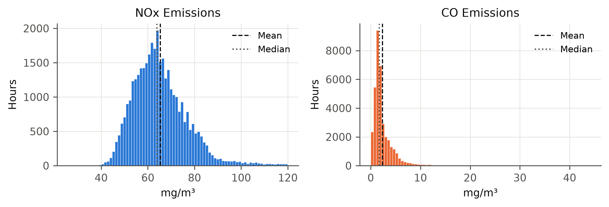
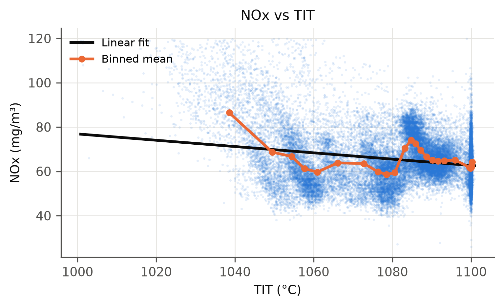
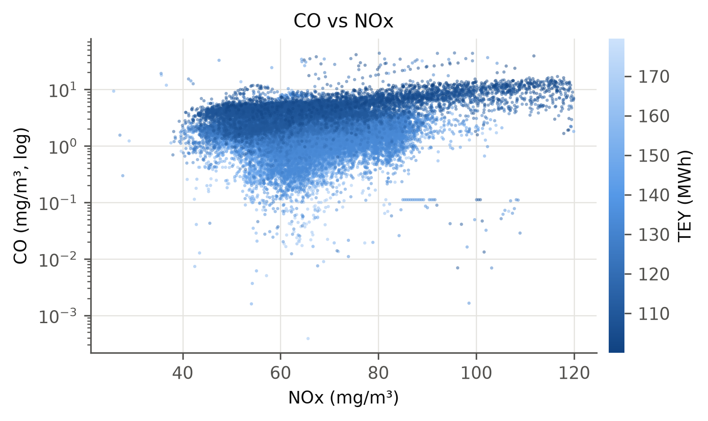
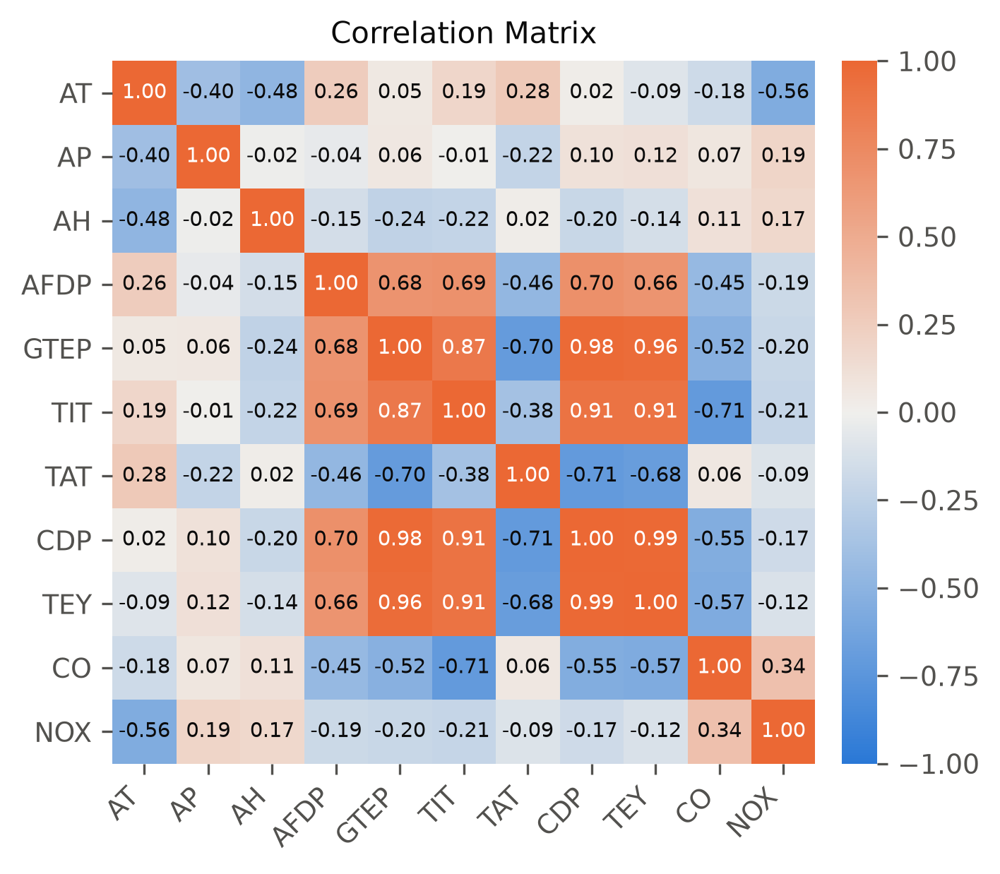
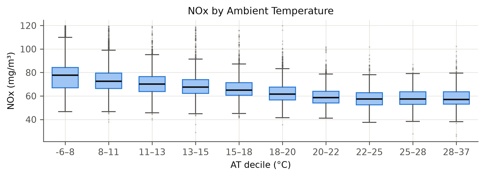
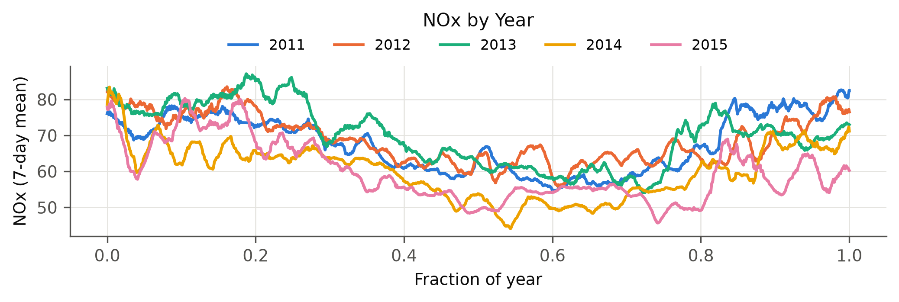

**ADSP 31014 Statistical Models for Data Science**
**Course Project Part 1 — Gas Turbine CO and NOx Emissions**
Obaro Erigha

## Overview of Data Set

The data set contains 36,733 hourly records from a natural-gas-fired gas turbine at a combined-cycle power plant in north-western Turkey, covering 2011–2015. It was obtained from the UCI Machine Learning Repository (*Gas Turbine CO and NOx Emission Data Set*; Kaya, Tüfekci & Uzun, 2019), where it was published as a benchmark for predictive emission monitoring systems (PEMS). Each record is the hourly average of 11 sensor signals: 3 ambient conditions, 6 process measurements around the compressor, combustor and turbine, the turbine energy yield, and 2 regulated flue-gas emissions, carbon monoxide (CO) and nitrogen oxides (NOx). The data come as five annual files with no timestamps; rows within each file are in chronological order, per the source.

*Figure 1: NOx Emissions (left) and CO Emissions (right), hourly, 2011–2015.*

## Data Table Schema

The cleaned data set has 36,624 rows and 13 columns: the 11 sensor signals plus `year` and `row_in_year`, both added during wrangling. Each row is one operating hour. All sensor columns are continuous decimals with no missing values; units follow the UCI documentation. Statistics below are for the cleaned data.

| Column Name | Description | Data Type | Example Value | Notes |
| --- | --- | --- | --- | --- |
| AT | Ambient temperature (°C) | decimal | 4.588 | • Range −6.2 to 37.1; mean 17.7 • 62 hours below 0 °C; strong winter–summer cycle |
| AP | Ambient pressure (mbar) | decimal | 1018.7 | • Range 985.9–1036.6; 0.1 mbar resolution |
| AH | Ambient relative humidity (%) | decimal | 83.675 | • Range 24.1–100.2; left-skewed (median 80.5) • 478 hours above 100 % (sensor saturation) |
| AFDP | Air filter differential pressure (mbar) | decimal | 3.576 | • Range 2.1–7.6 • Annual mean falls from 4.31 (2012) to 3.60 (2015) |
| GTEP | Gas turbine exhaust pressure (mbar) | decimal | 23.979 | • Range 17.7–40.7 • Near-duplicate of CDP and TEY (r ≥ 0.96) |
| TIT | Turbine inlet temperature (°C) | decimal | 1086.2 | • Range 1000.8–1100.9; left-skewed • 19.3 % of hours within 1 °C of the maximum |
| TAT | Turbine after (exhaust) temperature (°C) | decimal | 549.83 | • Range 511.0–550.6 • 63.9 % of hours within 1 °C of the maximum |
| CDP | Compressor discharge pressure (mbar) | decimal | 11.898 | • Range 9.9–15.2; r = 0.99 with TEY |
| TEY | Turbine energy yield (MWh) | decimal | 134.67 | • Range 100.0–179.5 |
| CO | Carbon monoxide (mg/m³) | decimal | 0.327 | • Median 1.72, mean 2.38, max 44.1 • Highly right-skewed (skew 4.8) |
| NOX | Nitrogen oxides (mg/m³) | decimal | 81.952 | • Median 63.9, mean 65.3, range 25.9–119.9 • Annual mean drops by 8–10 in 2014–2015 |
| year | Source file year (added) | integer | 2011 | • 2011–2015; 7,151–7,628 rows per year |
| row_in_year | Row position in annual file (added) | integer | 0 | • Proxy for time of year; used in Figure 6 |

## Data Cleaning and Processing

The five annual files were concatenated and tagged with `year` and `row_in_year`. No column had missing values. Two data-quality problems were found, and the affected rows were removed:

- **Exact duplicate records (7 rows):** two runs of identical consecutive rows in 2014 (5 and 4 copies; the first of each was kept).
- **Frozen NOx analyzer (102 rows):** NOx reads exactly 60.38 mg/m³ for 102 consecutive hours in 2011 while every other signal keeps moving. Since hourly averages rarely repeat for more than a few hours, any run of 12 or more identical NOx readings was treated as an analyzer fault.

Boundary values were kept: relative humidity slightly above 100 % (sensor saturation), TIT and TAT at their control ceilings, and CO readings up to 44 mg/m³. These reflect sensor limits or real operating states rather than data-entry errors. The cleaned data set has **36,624 rows**.

## Exploratory Findings

**Emission distributions (Figure 1).** NOx is unimodal and centred at 60–65 mg/m³, with a right tail: the 99th percentile is 105 and the maximum 120. CO is far more skewed: its median is only 1.72 mg/m³, yet 1 % of hours exceed 11 mg/m³.

*Figure 2: NOx vs TIT.*

*Figure 3: CO vs NOx, coloured by TEY.*

**NOx vs TIT (Figure 2).** Combustion theory predicts that NOx rises with firing temperature, but the pooled data show the opposite on average: the linear fit has a slope of −0.14 mg/m³ per °C and explains only 4.6 % of the variance. Hours below 1050 °C (6.3 % of the data, mostly part load) average 80.5 mg/m³ of NOx, against 64.3 above. NOx is fairly flat near 60 between about 1055 and 1080 °C, then jumps to 70–74 in a distinct cluster at 1083–1087 °C, the base-load operating point. The relationship is clearly non-linear and depends on load.

**CO vs NOx (Figure 3).** Theory predicts a trade-off between the two pollutants: hotter, more complete combustion lowers CO but raises NOx. The CO side holds: CO falls sharply as firing temperature rises (r = −0.71 with TIT), from a mean of 6.2 mg/m³ below 110 MWh to 1.2 mg/m³ above 160 MWh. The NOx side does not appear as a simple inverse relationship. At part load the turbine emits more of both pollutants (overall r = +0.34).

*Figure 4: Correlation Matrix.*

**Correlation structure (Figure 4).** The process variables form one tightly correlated block that describes turbine load: CDP–TEY r = 0.99, GTEP–CDP 0.98, GTEP–TEY 0.96 and TIT–TEY 0.91. This indicates severe multicollinearity among the load variables. TAT is negatively related to that block because exhaust temperature is held at its control limit as load increases. Ambient temperature is the strongest single correlate of NOx (r = −0.56), while every load-related variable has only a weak marginal correlation with NOx (|r| ≤ 0.21).

**Ambient temperature (Figure 5).** Median NOx falls steadily from 77.6 mg/m³ in the coldest decile (below 7.9 °C) to 57.3 at 22.5–24.9 °C, then levels off near 57 in the three warmest deciles. The relationship holds in every year, with within-year correlations of r = −0.57 to −0.67.

*Figure 5: NOx by Ambient Temperature (decile bins).*

## Anomalies and Interesting Aspects

*Figure 6: NOx by Year (7-day rolling mean).*

- **Step change in NOx after 2013 (Figure 6).** Annual mean NOx is 67.7, 68.8 and 70.0 mg/m³ in 2011–2013, then drops to 60.1 in 2014 and 59.9 in 2015. Ambient conditions and output did not shift comparably: annual mean AT and TEY stay within 1.2 °C and 3.4 MWh of each other across all five years. Every year also shows the same winter-high, summer-low seasonal cycle.
- **Frozen sensors.** Besides the removed NOx run, CO repeats one value (0.11124 mg/m³) 21 times early in 2014. This is the horizontal streak near 0.1 in Figure 3.
- **Varying part-load share.** Part-load hours (TEY below 110 MWh) range from 2.6 % in 2011 to 16.0 % in 2013, so each year's emissions partly reflect how the unit was operated.
